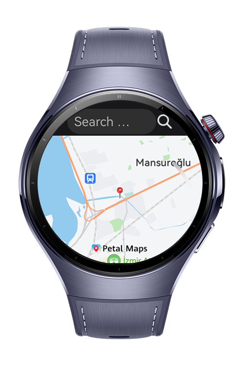
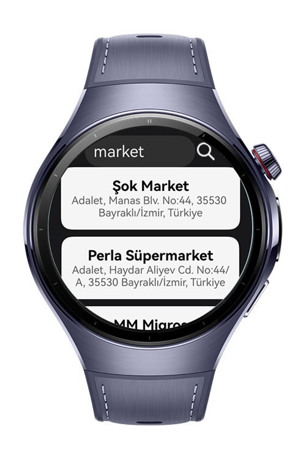
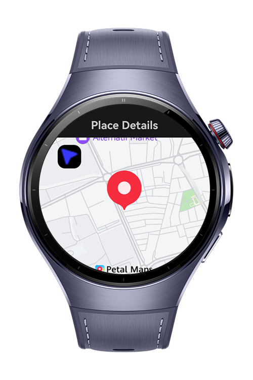
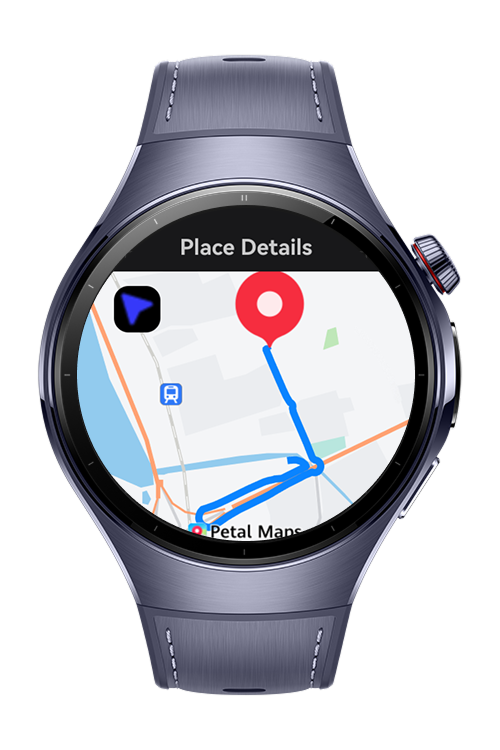

> **Note:** To access all shared projects, get information about environment setup, and view other guides, please visit [Explore-In-HMOS-Wearable Index](https://github.com/Explore-In-HMOS-Wearable/hmos-index).

# Map Explorer App

This demo showcases a smartwatch-friendly, location-based navigation application built using HarmonyOS NEXT APIs.
Designed with wearable device constraints in mind, it provides an intuitive and lightweight interface for quick navigation directly from your wrist.
The application enables users to:
- Search for places (POI) using text-based queries.
- View detailed information for a selected location with a corresponding map marker.
- Draw and display a driving route from a predefined static location to the chosen destination.

# Preview
<div>
   
  
  
  
</div>


# Use Cases
This application is ideal for developers and testers who want to explore location-based navigation features for
HarmonyOS smartwatches without depending on live GPS data. Some example scenarios include:
1. Prototype testing – Simulate navigation flows using a fixed starting point before implementing live location retrieval.
2. UI/UX design validation – Experiment with smartwatch-friendly map interfaces without requiring outdoor field testing.
3. Learning and experimentation – Understand how to integrate HarmonyOS map APIs, POI search, and route drawing in a smartwatch context.

By combining POI search, map visualization, and route rendering from a predefined location, this demo serves as a reference for building HarmonyOS watch apps with navigation features.

# Technology

## Stack
- Languages: ArkTS
- Frameworks: HarmonyOS SDK 5.1.0(18)
- Tools: DevEco Studio Vers 5.1.0.823
- Libraries
  - `@kit.MapKit`: map, search, and route planning
  - `@kit.LocationKit`: getCurrentLocation
  - `@kit.AbilityKit`: permission check and request
  - `@hms.core.map.site`: POI detail lookup
  - `@hms.core.map.navi`: route planning

## Required Permissions
- `ohos.permission.LOCATION`
- `ohos.permission.APPROXIMATELY_LOCATION`


# Directory Structure
```
entry/src/main/ets/
|---common
|   |---types.ets                  // POI and LatLng models
|---components
|   |---PoiCard.ets                // POI card component with navigation
|   |---SearchInput.ets            // Keyword search input
|---pages
|   |---HomePage.ets               // Home view with map, POI search
|   |---PlaceDetailPage.ets        // POI detail view with route planner
|---services
|   |---GlobalContext.ets          // Context DI
|   |---LocationService.ets        // Permission & location access1`
|   |---NavigationService.ets      // Route planning logic
|   |---SiteService.ets            // POI search service
|---resources
|---module.json5                   // Permissions and meta config
```

# Constraints and Restrictions

## Supported Device
- Huawei Watch 5

## Preparations Before Run
- You must **manually sign the application** before running it.  
- Otherwise, the map will appear as a **white screen** with no information.  
- [🔗 Learn how to sign your application](https://developer.huawei.com/consumer/en/doc/harmonyos-guides/map-config-agc)

- [🔗 Map kit supported countries/regions](https://developer.huawei.com/consumer/en/doc/harmonyos-guides/map-supported)


# License
Map And Navigation App is distributed under the terms of the MIT License. See the [LICENSE](/LICENSE) for more information.